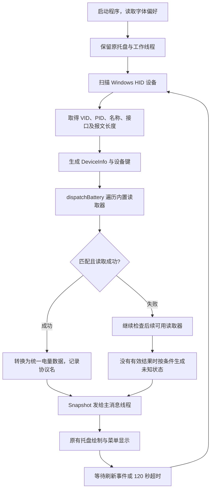

# BatteryIndicator 第二版：版本说明与实现流程

> 版本：v0.2.0。整理日期：2026-11-04。功能实现基于提交 `4432206`；本次将详细说明纳入完整版本，并按用户要求重新发布 `v0.2.0` 标签，最终提交以 Git 标签记录为准。本文依据当前源码和项目验证记录整理；电量和内存数字均为开发时的历史采样。

## 一、第二版主要完成了什么

第二版把第一版中的设备读取分支整理成统一的自动识别入口，并增加部分品牌的内置电量协议。用户只需要启动程序，程序会自动扫描连接的设备、匹配已有协议、查询电量，再交给原来的托盘界面显示。

本版没有要求用户查找配置文件、上传驱动或手动选择协议。设备协议随程序一起编译，用户使用一个 EXE 即可。

需要明确的是：统一的是程序入口、设备分流方式和最终电量数据；各品牌底层报文仍有区别。程序能够自动使用已有的协议实现，遇到没有适配过的私有协议时，仍可能无法读取。

### 1.1 与第一版的区别

| 项目 | 第一版 v0.1.0 | 第二版 v0.2.0 |
| --- | --- | --- |
| 设备分流 | 在扫描过程中直接判断罗技、高斯及标准 HID | 统一生成设备信息，由注册表选择读取器 |
| 协议组织 | 查询函数集中在主文件中，扫描逻辑直接调用 | 新增 `src/protocols.h`，注册匹配和读取函数 |
| 简单报文解析 | 以已有设备的专用实现为主 | 增加共用的 `PacketRule`、`queryPacket()`、`parsePacket()` |
| 内置范围 | 罗技、高斯和标准 HID Feature 分支 | 保留原范围，新增部分雷蛇、HyperX、SteelSeries 协议 |
| 多接口设备 | 主要使用原有设备键去重 | 新增厂商设备使用 Windows Container ID 辅助去重 |
| 诊断信息 | 主要显示设备及电量 | 增加协议名称和 `--supported` 内置范围输出 |
| 未知状态 | 电量无法读取 / 协议未适配 | 更明确地区分协议未知和已匹配但无有效读数 |
| EXE 大小 | 153,600 字节，150 KiB | 158,720 字节，155 KiB |

第二版保持原来的运行方式和界面习惯，包括粉色数字、字体选择、登录自启、托盘菜单和刷新周期。

### 1.2 当前保留的功能

- 每台已识别设备一个数字托盘图标，悬停查看名称和电量。
- 正常读数亮粉色 `#FF2D95`，低电量红色，已识别为充电时绿色，未知灰色。
- 三位数 `100` 自动缩小并居中，使用 4 倍采样平滑边缘。
- 七种字体可选，保留 Times New Roman 和字体偏好记忆。
- 默认 120 秒刷新，支持手动刷新、设备变化和系统恢复后的刷新请求。
- 当前用户登录自启、单实例、正常退出和命令行诊断。
- 继续使用原生 C + Win32，运行不依赖 Python、.NET、Electron 或厂商软件常驻。

## 二、需求如何转化为实现方案

本次升级的核心要求是：让用户只操作一个程序，并保持现有功能不变。

如果把适配工作交给用户，让用户自行准备协议 JSON，虽然可以降低开发者修改程序的频率，但使用门槛较高。第二版因此选择将已知协议内置：开发者负责协议维护，普通用户负责运行程序。

实现时遵循以下顺序：

1. 核对第一版源码、版本、已保存字体和自启路径。
2. 保留罗技、高斯的原有查询与解析函数。
3. 抽象统一的设备信息和读取器接口。
4. 将原有设备接入统一调度入口。
5. 提取简单报文共有的查询、校验和换算过程。
6. 根据已查阅的协议来源增加新设备读取器。
7. 为错误报文、匹配条件和图标显示增加或保留测试。
8. 编译替换程序，回归本机设备，核对资源占用与设置。
9. 整理说明、提交源码及 EXE，并推送 v0.2.0 标签。

这次没有重新编写字体绘制或自启机制，而是在设备读取部分增加一层统一接口，减少对现有功能的影响。

## 三、整体运行流程



设备查询在工作线程完成，主线程负责 Windows 消息和托盘界面。每次扫描生成一份快照，通过消息交给主线程更新，不在菜单回调中同步扫描所有设备。

## 四、第一步：统一设备信息

在 [src/protocols.h](src/protocols.h) 中定义 `DeviceInfo`：

```c
typedef struct {
    HIDD_ATTRIBUTES attributes;
    HIDP_CAPS caps;
    PHIDP_PREPARSED_DATA preparsed;
    const WCHAR *path, *name, *key;
} DeviceInfo;
```

| 字段 | 用途 |
| --- | --- |
| `attributes` | 设备 VID、PID 等标识 |
| `caps` | Usage Page、Usage 及各类报文长度 |
| `preparsed` | 供标准 HID 字段解析使用的描述数据 |
| `path` | 打开具体 HID 接口的路径 |
| `name` | 设备名称及部分型号匹配依据 |
| `key` | 合并同一设备结果、区分不同设备的标识 |

主文件的 `scan()` 仍使用 SetupAPI 和 HID API 枚举设备。与第一版相比，取得元数据后不再直接执行一串厂商查询分支，而是构造 `DeviceInfo` 并交给统一调度函数。

这里尤其需要区分“设备”和“接口”：同一个 USB 接收器可能提供键盘输入、媒体控制和厂商通信等多个 collection。读取电量必须选对接口。

## 五、第二步：建立内置协议注册表

### 5.1 读取器接口

所有内置读取器用同一种结构注册：

```c
typedef struct {
    const WCHAR *name, *description;
    BOOL (*matches)(const DeviceInfo*);
    BOOL (*read)(HANDLE, const DeviceInfo*, Snapshot*);
} BatteryProvider;
```

这个接口包含两个主要操作：

- `matches()`：检查当前设备是否符合该协议的使用条件。
- `read()`：对匹配设备执行电量查询，将结果写进快照。

读取器可以采用不同的底层传输方式。上层不需要知道它使用 Feature 报文、普通输入输出，还是多步特征查询。

### 5.2 当前的注册顺序

`providers[]` 依次包含：

| 顺序 | 名称 | 作用 |
| --- | --- | --- |
| 1 | GANSS | 高斯 GS3104T-PRO 原生电量协议 |
| 2 | HID++ | 罗技 HID++ 2.0 电量特征 |
| 3 | Razer | 列出的雷蛇鼠标 Feature 协议 |
| 4 | HyperX | Cloud II Wireless 电量和充电查询 |
| 5 | Nova7 | SteelSeries Nova 7 系列报文 |
| 6 | StandardHID | 描述符声明的 Battery Strength Feature |

标准 HID 在最后作为补充。`matchesStandard()` 先检查设备是否具有 Feature Value Caps 和 Feature 报文，真正读取时再确认有无 Battery Strength 字段；并非所有 Feature 接口都含电量。

### 5.3 调度逻辑

`dispatchBattery()` 逐个检查读取器。匹配成功才调用读取函数；取得有效结果后，写入协议名称并结束当前接口的调度。没有有效结果时，程序按设备情况生成未知条目。

开发者以后增加读取器，需要实现匹配和读取函数，再加入注册表。普通用户不需要处理这一步，也不需要准备配置文件。

## 六、第三步：共用简单报文的解析过程

### 6.1 `PacketRule` 表达什么

HyperX 和 Nova 7 的简单请求响应通过 `PacketRule` 描述，共用查询及解析函数。

| 规则字段 | 含义 |
| --- | --- |
| `request`、`requestLength` | 查询字节和有效长度 |
| `prefix`、`prefixLength` | 响应必须匹配的前缀 |
| `minimumReply` | 最小响应长度 |
| `levelOffset` | 电量字段的字节偏移 |
| `stateOffset`、`onlineState` | 可选的在线状态条件 |
| `chargingOffset`、`chargingValue` | 可选的充电状态字段和值 |
| `scale` | 原始电量刻度的上限 |
| `skipZeroReportId` | 某些布局是否跳过前导零 Report ID |
| `allowedStatusMask` | 允许接受的状态值集合 |
| `chargingMask` | 表示充电的状态值集合 |

这些规则是源码中的常量，不是用户上传的文件。它们允许不同的报文布局复用读取和解析代码。

### 6.2 `queryPacket()` 的处理步骤

1. 检查接口声明的输入、输出长度是否在缓冲区容量内。
2. 建立清零的请求缓冲区，复制有效查询字节。
3. 按接口实际输出长度发送报文。
4. 在当前查询的截止时间前等待输入响应。
5. 每次收到报文都调用 `parsePacket()` 判断是否有效。
6. 找到有效读数立即返回；超时或传输失败则返回失败。

普通报文复用已有 `transfer()` 处理重叠读写、停止事件与超时。当前写入等待参数为 500 毫秒，响应循环使用约 1 秒的截止时间。这是应用侧等待策略，不是对所有 Windows 驱动延迟的绝对保证。

### 6.3 `parsePacket()` 的校验顺序

根据规则跳过可选的前导零后，依次检查：响应长度、响应前缀、电量偏移、在线状态、电量范围和充电字段范围，再计算读数。

通用换算公式是整数运算：

```text
percent = raw × 100 / scale
```

例如 `scale = 100`、原始值为 68，则显示 68%；`scale = 4`、原始值为 3，则显示约 75%。后者是离散等级，程序设置 `approximate` 标志，提示中带“约”。

响应不能仅因为某个字节落在 0～100 就被当作电量。接口上可能有其他数据，在线状态也可能表明耳机已经关闭，即使响应里仍保留着之前的电量值。

## 七、第四步：接入各品牌读取器

### 7.1 高斯：保留已实测的原生查询

匹配条件包含 VID `05AC`、PID `024F`、名称包含 `GS3104T-PRO`，以及 collection `FF60:0061`。

`readGanss()` 打开接口后继续调用原来的 `ganss()`，沿用 33 字节请求、命令 `20 01`、加法校验和以及 `parseGanss()` 校验。

本版没有重新猜测高斯协议，也没有改用此前未能获得有效响应的网页驱动命令。协议来源仍是第一版对本机官方原生驱动的分析和硬件验证。

### 7.2 罗技：保留 HID++ 动态特征读取

匹配罗技 VID `046D` 和 collection `FF00:0002`。`readLogitech()` 继续调用原有 `logitech()`，查找 `0x1004` 或 `0x1000` 电量特征，再完成查询和设备名称读取。

罗技查询包含槽位扫描和特征索引发现，不适合只描述成“固定报文的某一字节是电量”。因此它保留专用处理器，但接入统一的上层接口。

### 7.3 雷蛇：增加 Feature 报文处理器

雷蛇分支包含 16 个 USB ID、9 个鼠标型号。匹配条件为 VID `1532`、PID 在内置表中，且 Feature 报文长度为 91。

处理流程：

```text
查找型号对应的 transaction ID
  → 构造 Feature 电量请求
  → HidD_SetFeature
  → 等待并调用 HidD_GetFeature
  → 校验响应
  → 查询充电状态
  → 换算百分比并写入快照
```

电量命令类为 `0x07`，电量命令 `0x80`，充电命令 `0x84`。91 字节缓冲区包含 Report ID，内部为 90 字节协议载荷。

解析函数检查长度、Report ID、成功状态、事务 ID、数据长度、命令类、命令和 XOR 校验。事务 ID 用于区分请求，避免把其他通信的回复当成本次电量结果。

原始电量范围为 0～255，代码采用：

```text
percent = (raw × 100 + 127) / 255
```

例如原始值 171 被换算为约 67%。这里是将原始刻度四舍五入为整数百分比。

这条路径使用自己的 Feature 传输逻辑，不经过 `queryPacket()` 的普通输入输出流程。

### 7.4 HyperX：复用通用解析器

匹配 HyperX Cloud II Wireless 的 VID `03F0`、PID `0696` 或 `018B`，以及 collection `FF90:0303`。

| 查询 | 有效请求开头 | 响应字段 |
| --- | --- | --- |
| 电量 | `06 FF BB 02` | 偏移 7 的百分比 |
| 充电 | `06 FF BB 03` | 偏移 4，值 1 表示充电 |

两条规则均要求至少 20 字节的响应，且响应前缀与查询命令对应。电量查询成功后，另行查询充电状态。

充电规则内部使用 `scale = 1`：原始值 1 转为 100，读取器再把它转换为布尔充电标志。这个临时值不会作为耳机电量显示。

### 7.5 SteelSeries Nova 7：同时处理在线状态和等级差异

匹配 VID `1038`、collection `FFC0:0001` 和列出的 15 个 USB ID。请求开头为 `00 B0`。

响应规则要求 `B0` 前缀、连接状态为 3，并检查状态字节：1、2 表示充电，3 表示使用电池，0 不接受为在线读数。

其中 9 个 ID 使用直接百分比布局，另外 6 个 ID 使用 0～4 的等级布局。读取函数按 PID 选择刻度，等级值转换为约 0%、25%、50%、75%、100%。

### 7.6 标准 HID：继续读取声明过的字段

标准分支从 HID 描述中寻找 Usage Page `0006`、Usage `0020` 的 Battery Strength Feature 字段，再按逻辑范围换算。

它不对未知设备发送其他品牌的私有电量命令，也不表示能读取所有标准 Input 电量报文。当前实现范围仍限于相应 Feature 字段。

完整型号及 PID 表见 [AUTO_DETECTION.md](AUTO_DETECTION.md)。

## 八、第五步：统一结果并处理去重

### 8.1 统一读数

通用报文解析先生成 `Reading`：

```c
typedef struct {
    int percent;
    int charging;
    int approximate;
} Reading;
```

各读取器通过 `add()` 将结果放入 `Snapshot`，供托盘使用。专用的高斯、罗技处理器可以直接更新快照，不必先构造 `Reading`。

第二版给 `Battery` 增加 `protocol` 字段。读取成功后，调度器填入 `GANSS`、`HID++` 等名称，因此上层能统一显示电量，也能在诊断中说明结果来自哪个读取器。

### 8.2 Container ID 的作用

主扫描函数尝试读取 `DEVPKEY_Device_ContainerId`，将其和 VID、PID 组合成新设备键。同一物理设备的复合 collection 通常共享 Container ID，因此新增厂商读取器可以合并重复接口的读数。

无法取得有效 Container ID 时，回退到接口路径。回退只能提供接口级标识，不能保证不同 collection 一定合并。

为保持原来的设备行为，高斯和罗技保留原有键策略。相同型号的多把高斯键盘仍使用同一个键，目前会合并显示，这是尚未解决的限制。

## 九、第六步：区分两种未知状态

### 协议未支持

没有匹配的厂商读取器，也没有可读取的标准字段。对于名称包含 `2.4G` 或 `GANSS` 等特征的设备，可以创建 `Unknown` 条目，显示灰色 `?`，悬停提示“协议暂未支持”。

程序不能从所有普通 USB 产品名称判断它是不是无线接收器，因此不是每个未知设备都会出现在托盘。

### 协议匹配但没有有效读数

识别到了已内置协议，但可能因休眠、离线、接口无法打开、超时或响应不合格而读不到电量。此时记录读取器名称，显示设备休眠、离线或暂时无法读取。

这些原因在界面上归为同一类，程序没有保证能进一步自动判断出准确原因。设备唤醒后可手动刷新，或等待下一次周期查询。

第二版还处理了高斯的占位条目：扫描到较早的非电量 collection 时可能先建立未知项，后续识别到真正电量接口，即使设备当时休眠，也会把协议名称更新为 `GANSS`，避免把已适配设备误标为协议不支持。

## 十、第七步：保留原界面与低占用方式

本次没有改变字体编号、注册表路径、颜色选择、图标缩放方式及托盘菜单操作。用户原先保存的 Times New Roman 对应编号 6，升级后继续使用。

自启仍写入当前用户的 Run 项，指向原来的 EXE 路径。它在用户登录后运行，不是登录前的系统服务。保持路径不变时，更新程序无需重新设置自启。

后台继续采用事件等待和低频查询。新增读取器只有设备匹配时才执行，不会在每次扫描中对所有设备依次试发所有厂商命令。程序没有增加在线协议下载、常驻解释器或动画。

| 指标 | v0.2.0 记录 | 说明 |
| --- | --- | --- |
| EXE | 158,720 字节，155 KiB | 比 v0.1.0 增加约 5 KiB |
| 工作集 | 一次采样约 10.45 MiB | 随系统与设备状态变化 |
| 私有内存 | 一次采样约 1.98 MiB | 与工作集是不同指标 |
| 空闲 CPU | 15 秒采样中 CPU 时间增量 0 ms | 不代表长期绝对零占用 |

程序指纹：

```text
D733B8BC4A135722D512E8364DB11936B9606C9D12B14A44D7BC8D80EE507CA8
```

## 十一、第八步：测试与真实设备回归

测试入口仍是 `test.cmd`，测试源码为 [tests/protocol_test.c](tests/protocol_test.c)。

### 11.1 保留的测试

高斯真实响应样本、长度、命令、校验和、范围、零值和设备去重；以及 7 种字体 × 4 种尺寸 × 6 个数值，共 168 种图标组合。

图标检查要求生成非空字形且四周边界透明，继续防止 `100` 被裁切。

### 11.2 新增的测试

| 测试对象 | 主要检查 |
| --- | --- |
| HyperX 通用规则 | 正常读数、短报文、错误命令、超范围、零电量 |
| Nova 7 规则 | 百分比、充电、离线、可选前导零、离散等级范围 |
| 雷蛇报文 | 请求校验、有效响应、错误长度、事务 ID 不符、CRC 不符、非成功状态 |
| 设备匹配 | 高斯名称、HyperX collection、雷蛇 PID 等约束 |
| 未适配接收器 | 生成未知状态，避免进入厂商查询 |
| 高斯占位项 | 后续匹配到读取器时更新协议名，不重复创建条目 |

这些是解析和分流测试，不能替代新型号的真实 USB 通信测试。

### 11.3 本机回归结果

| 检查 | 记录 |
| --- | --- |
| 罗技 PRO X Wireless | 统一入口成功读取，开发中读到 39%，后续收尾为 33% |
| 高斯 GS3104T-PRO | 按 Shift 唤醒后恢复 100%，后续收尾为 92% |
| 托盘 | 两个图标注册成功，2/2 |
| 字体 | 保存值仍为 6，即 Times New Roman |
| 自启 | 原路径保持不变 |
| 单实例 | 第二次启动正常退出，原进程继续运行 |
| 编译与文件检查 | 编译无警告，版本、文档链接和程序指纹检查通过 |

电量随时间变化，上表用于说明实际查询生效，不应写入程序作为固定值。休眠时显示未知是既有行为。

新增的雷蛇、HyperX 和 SteelSeries 对应硬件没有连接到本机，当前只能说明已实现查询和解析、并通过相应测试，不能宣称全部型号已实机验证。

## 十二、协议来源与本版支持边界

新增实现参考了开发时查阅的 HaloBattery 源码：

- [Razer provider](https://github.com/HeyOkay/HaloBattery/blob/main/providers/razer.py)：鼠标 ID、事务、Feature 请求和电量换算。
- [HyperX provider](https://github.com/HeyOkay/HaloBattery/blob/main/providers/hyperx.py)：Cloud II Wireless 的接口、查询及响应布局。
- [SteelSeries provider](https://github.com/HeyOkay/HaloBattery/blob/main/providers/steelseries.py)：Nova 7 系列 ID、在线状态和电量布局。

高斯和罗技的首次适配过程见 [项目实现全流程](BatteryIndicator_项目实现全流程.md)。第三方许可保留在 [THIRD_PARTY_NOTICES.md](THIRD_PARTY_NOTICES.md)。

当前仍未实现的范围包括：未知厂商协议自动推断、全品牌全型号通用、完整蓝牙扫描、HID++ 1.0，以及多把同型号高斯键盘分别显示。高斯充电状态也尚未验证。

因此，第二版的准确定位是：一个内置多种读取方式、自动选择处理器的轻量托盘程序。设备支持范围会随内置协议扩展，用户不需要维护配置。

## 十三、版本文件和发布流程

| 文件 | 用途 |
| --- | --- |
| [VERSION](VERSION) | 当前版本号 `0.2.0` |
| [CHANGELOG.md](CHANGELOG.md) | 各版本变更摘要 |
| [AUTO_DETECTION.md](AUTO_DETECTION.md) | 内置型号、协议结构和边界 |
| [VALIDATION.md](VALIDATION.md) | 编译、测试、硬件与资源测量记录 |
| 本文 | 本版统一的版本说明，包含从需求到实现、测试、发布及更新的完整讲解，替换此前简版说明 |

功能提交 `4432206` 最初已推送至 [baiye099/BatteryIndicator](https://github.com/baiye099/BatteryIndicator)。本次在其后增加文档整理提交，移除旧简版说明，纳入本文，并重新发布附注标签 `v0.2.0`，使该版本同时包含程序、源码和完整说明。程序内容与指纹保持不变。

如果本地已经取得过旧的 `v0.2.0` 标签，需要显式刷新该标签才能与本次重新发布的版本一致：

```powershell
git fetch origin main
git fetch origin +refs/tags/v0.2.0:refs/tags/v0.2.0
```

该命令仅更新远程分支记录及本地标签，不会切换当前分支或改写工作区文件。

构建或维护时，先退出正在运行的旧程序，再执行：

```powershell
.\build.cmd
.\test.cmd
```

日常运行使用 `启动.cmd`；开关登录自启分别使用 `开启自启.cmd`、`关闭自启.cmd`。更新时保持程序路径不变，可继续沿用原自启设置；移动目录后需要重新开启自启。

诊断命令：

```powershell
# 输出内置支持范围
Start-Process .\bin\BatteryIndicator.exe -ArgumentList '--supported' -Wait
Get-Content .\bin\supported.txt

# 输出正在运行实例的托盘状态
Start-Process .\bin\BatteryIndicator.exe -ArgumentList '--status' -Wait
Get-Content .\bin\status.txt
```

`--supported` 和 `--status` 会生成诊断文本文件，普通运行不依赖这些文件。`--status` 输出中的 `-1%` 是未知值，不表示真实负电量。

原创部分继续采用项目既有的 [PolyForm Noncommercial 1.0.0](LICENSE)，中文使用说明见 [LICENSE.zh-CN.md](LICENSE.zh-CN.md)，第三方材料保留其原有许可。
