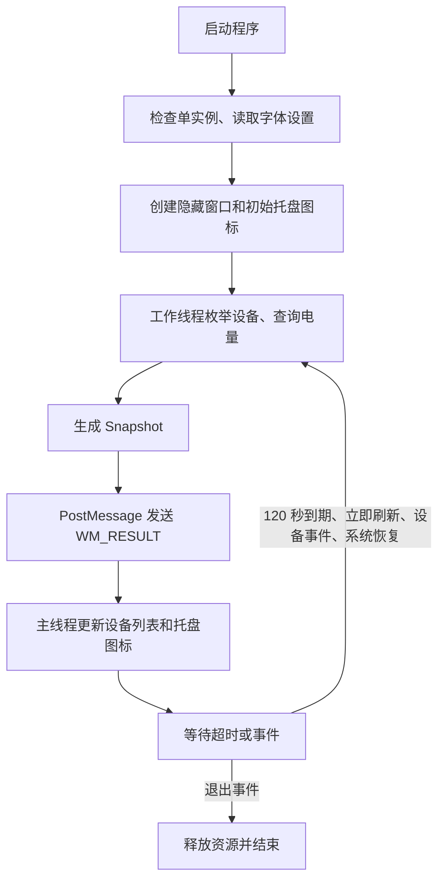

# BatteryIndicator：从设备协议到轻量托盘电量显示的完整实现

> 文档日期：2026-11-04。本文依据项目当前源码、实际构建产物和本次开发中的硬件验证编写。涉及电量、内存的数字均为当时采样，不是固定值。日常使用请先阅读 [README.md](README.md)，历史验证记录见 [VALIDATION.md](VALIDATION.md)。

## 1. 项目从什么需求开始

目标是在 Windows 右下角系统托盘显示通过 2.4G 接收器连接的外设电量，并在用户登录后自动运行。用户特别强调：后台内存占用小、程序体积小。

最终主要适配两台设备：

| 设备 | 本机识别信息 | 本次验证 |
| --- | --- | --- |
| 罗技 PRO X Wireless 鼠标 | VID `046D`，接收器 PID `C547` | 成功读取，开发期间从 40% 变化到 39% |
| 高斯 GS3104T-PRO 键盘 | VID `05AC`，PID `024F`，名称 `GS3104T-PRO 2.4G` | 成功读取 100%，验证休眠后唤醒恢复 |

界面最终采用独立托盘图标：每台已识别设备一个数字，鼠标悬停显示名称及电量，点击展开菜单。此项目没有实现把外设条目加入 Windows 原生笔记本电池弹出面板。

后续增加了三项外观要求：三位数 `100` 不溢出、可以挑选字体、正常电量显示亮粉色。

## 2. 为什么不能直接写一个“所有 2.4G 设备通用”的脚本

2.4G 描述的是无线连接方式，不是统一的电量查询协议。电脑看到的通常是 USB 接收器，而接收器如何向电脑提供鼠标、键盘的电量，由厂商和具体固件决定。

因此，必须区分三个阶段：

1. **发现设备**：USB 接收器已连接，Windows 能枚举到它。
2. **匹配协议**：识别品牌、型号和正确的 HID collection。
3. **取得有效电量**：发送已知查询，核对响应格式，再转换成百分比。

第一阶段成功，不代表第三阶段成功。遇到设备休眠、无响应或尚未适配，程序显示未知；不会根据连接状态伪造百分比。

当前实现的是“自动扫描 + 已适配协议读取”，没有实现全品牌通用。标准 HID Battery Strength 也有读取分支，但它只覆盖设备主动声明该字段的情况。

## 3. 先参考开源项目，再确定技术路线

开发初期检索了 GitHub 上的同类实现：

| 参考项目 | 在本项目中的用途 |
| --- | --- |
| [HaloBattery](https://github.com/HeyOkay/HaloBattery) | 了解多设备电量应用的组织方式，以及各品牌协议需分别适配的事实 |
| [HaloBattery Logitech provider](https://github.com/HeyOkay/HaloBattery/blob/main/providers/logitech.py) | 核实 HID++ 电量特征、请求格式、状态解释 |
| [mousebatt](https://github.com/ryanlewis/mousebatt) | 参考精简原生托盘、低频查询的设计方向，没有复制其源代码 |
| [GANSS 官方产品页](https://www.ganss.cn/forum/post/334636/) | 确认键盘型号及官方驱动入口 |

项目最初称为“脚本”，但最终采用 **C + Win32 API**，因为核心需求是长期后台运行且尽量精简。本机已有 Visual Studio C++ 工具和 Windows SDK，可以直接生成原生 EXE。

运行时不需要 Python、.NET、Electron 或额外 HID 动态库。Python 只在开发期间用于离线研究、图片转换等辅助工作，不参与后台监控。

参考开源实现后保留了相应第三方许可说明，见 [THIRD_PARTY_NOTICES.md](THIRD_PARTY_NOTICES.md)。厂商驱动和固件没有复制进项目发布物。

## 4. 环境检查与真实设备识别

本机开发环境为 Windows x64、Visual Studio 2022、MSVC 14.39 和 Windows SDK 10.0.19041。项目所在目录虽然位于 Python 项目目录下，但实际应用是原生 C 程序。

开发时先检查目录和编译环境，再查看当前连接的设备。例如可以在 PowerShell 中执行：

```powershell
pnputil /enum-devices /connected /class HIDClass
pnputil /enum-devices /connected /class Keyboard
```

最初尝试过 `Get-PnpDevice`，但当时执行环境无法访问相关 CIM 资源，因此改用 `pnputil` 与 HID API。权限受限的执行沙箱也曾导致设备接口无法打开；在获准访问真实主机设备后才能做硬件验证。这不意味着最终程序需要管理员权限。

### 4.1 HID 枚举的代码流程

`src/battery.c` 中的 `scan()` 完成：

```text
HidD_GetHidGuid
  → SetupDiGetClassDevsW
  → SetupDiEnumDeviceInterfaces
  → SetupDiGetDeviceInterfaceDetailW
  → CreateFileW
  → HidD_GetAttributes / HidD_GetProductString
  → HidD_GetPreparsedData / HidP_GetCaps
  → 按 VID、PID、名称、Usage Page、Usage 分流
```

`HIDP_CAPS` 还提供输入、输出和 Feature 报文长度。查询时必须使用接口声明的长度，不能把同一接收器的键盘输入接口误当成厂商通信接口。

### 4.2 为什么一个接收器会出现很多条记录

复合 USB 设备可能同时提供键盘输入、鼠标输入、媒体控制、厂商通信等 collection。列表里有多行同名设备，不代表插了多台设备。

当前适配所需的主要 collection：

| 用途 | Usage Page | Usage |
| --- | --- | --- |
| 罗技 HID++ 长报文接口 | `FF00` | `0002` |
| 高斯电量命令接口 | `FF60` | `0061` |
| 标准 Battery Strength 字段 | `0006` | `0020`，需检查 Feature 描述 |

高斯的 `05AC:024F` 标识还会被其他设备使用，所以程序同时匹配型号名称与 collection，而不是只看 VID/PID 就发查询。

## 5. 罗技鼠标：通过 HID++ 2.0 查询电量

主要函数是 `request()`、`featureIndex()` 和 `logitech()`。

### 5.1 请求格式

使用长报文形式：

```text
11  slot  featureIndex  (function << 4 | softwareId)  parameters...
```

- `11` 是长报文标识。
- `slot` 标识接收器内的设备槽位。
- `featureIndex` 是设备实际返回的特征索引，不是固定的特征编号。
- `softwareId` 帮助识别属于本次请求的回复。

程序的 software ID 在 `0x0A` 到 `0x0F` 间轮换。响应只有在槽位、特征索引、功能及 software ID 相符时才被接受；相应错误响应则结束本次请求。

### 5.2 查找电量特征

特征编号与查询方式：

| 优先级 | 特征编号 | 用途 | 查询功能 |
| --- | --- | --- | --- |
| 1 | `0x1004` | Unified Battery | function 1 |
| 2 | `0x1000` | Battery Status | function 0 |

通过根特征查询到实际索引后，再发送电量请求。程序按产品名中是否包含 `Receiver` / `receiver` 判断槽位扫描方式：接收器尝试 1～6，直接设备尝试 `0xFF`。这个判断属于当前实现的简化方式，并非覆盖所有罗技设备的完整识别表。

另外查询 `0x0005` 名称特征，将设备显示成 `PRO X Wireless`，而不只是 `USB Receiver`。

### 5.3 读数与近似值

通常从响应参数中取得百分比和充电状态。`0x1004` 如果只提供离散等级，则映射为近似百分比，并在提示文字中加“约”。近似等级不能被当作精确电量测量。

本机 PRO X Wireless 已完成真实读取验证。HID++ 1.0、仅返回电压的型号等没有在当前版本中实现，不能据此宣称所有罗技设备都已支持。

## 6. 高斯键盘：网页命令未奏效，转向原生驱动

高斯的适配是本次开发中最关键的排查过程。

### 6.1 第一条路径：分析官方网页驱动

从官方产品页找到 [网页驱动](https://ganss.driveall.cn/)，下载公开脚本作离线分析。网页中存在设备信息查询、`batteryLevel` 等字段，因此先尝试其查询格式。

但在本机这把 GS3104T-PRO 上，该命令没有返回有效电量。后来用户确认序列号以 DSMW 开头，也确认官方原生驱动能够看到电量。

这说明不能仅凭网页里有相同型号，就认定它的通信方式适用于当前接收器。最终实现没有继续保留这条无效查询路径。

### 6.2 第二条路径：核对已安装的官方原生驱动

本机已有 `GS3104T-PRO Driver Beta 1.0.0.3`。先读取安装目录中的 `config.xml`，确认设备名和接口信息，再对 `DeviceDriver.exe` 进行离线反汇编分析。

开发期间临时使用 `pefile` 和 `capstone` 辅助读取 PE 文件与指令，研究内容保存在临时目录。这些库不是应用依赖，完成协议适配后已清理。

通过电池控件资源定位界面更新位置，再追踪其上游查询函数，最终确认：

- 电量查询函数地址：`0x4357A0`。
- 传输及校验处理函数地址：`0x44F490`。
- 该版本 ImageBase：`0x400000`。

这些地址只用于说明当时分析的具体版本，程序运行时不会调用厂商 EXE 的内部地址，也不要求厂商软件常驻。

### 6.3 最终电量请求

请求总长度为 **33 字节**，使用 Report ID `0x00`：

```text
位置       0    1    2    3 ... 31    32
内容      00   20   01   00 ... 00   21
```

最后一个字节是前 32 字节之和的低 8 位：

```text
checksum = sum(bytes[0..31]) & 0xFF
         = (0x20 + 0x01) & 0xFF
         = 0x21
```

本机捕获到的 100% 响应为：

```text
00 20 01 00 64 00 ... 00 85
```

其中 `0x64` 是十进制 100。校验结果是 `0x20 + 0x01 + 0x64 = 0x85`。

### 6.4 解析前的校验

当前 `parseGanss()` 按顺序核对：

1. 响应长度必须为 33。
2. Report ID 必须为 `00`。
3. 命令字段必须为 `20 01`。
4. 电量字段 `rx[4]` 必须在 1～100。
5. 前 32 字节之和的低 8 位必须等于 `rx[32]`。

任意条件不满足，返回 `-1`，表示没有有效读数。原生驱动对零值不作为有效电量更新，当前实现保持该处理方式。因此键盘返回零时显示未知，不能据此断言真实电量就是 0%。

程序仅发送已定位的电量读取命令，没有发送按键修改、灯光修改、宏写入、配对、恢复出厂或固件升级指令。当前没有验证高斯充电状态，所以只展示其百分比。

## 7. 标准 HID 电量字段作为补充

`standardBattery()` 检查设备描述中的 Feature Value Caps，寻找 Usage Page `0x06`、Usage `0x20`。

只有描述中确实声明了该字段，才调用 `HidD_GetFeature()` 和 `HidP_GetUsageValue()` 读取。若逻辑范围有效，按下面公式换算：

```text
percent = (value - logicalMin) × 100 / (logicalMax - logicalMin)
```

这条路径不猜测厂商命令，也不等价于完整的通用 HID 电池支持：当前没有实现通过 Input 报文被动监听所有标准电量字段，也没有在本机上用另一台标准电量设备进行硬件验证。

## 8. 程序如何在后台低频运行

应用由一个主消息线程和一个查询工作线程组成。系统库可能另外创建线程，因此任务管理器看到的线程总数不一定是 2。



### 8.1 数据结构

`Battery` 保存设备标识、名称、百分比、充电标志和是否近似；`Snapshot` 保存一次扫描得到的设备列表，当前最多 32 项。

工作线程动态分配快照，将其指针传给主线程。发送失败时由工作线程释放，发送成功后由主线程使用并释放。设备查询不会占用主线程等待，因此打开托盘菜单不必等整个扫描完成。

### 8.2 等待机制

刷新间隔为：

```c
#define INTERVAL 120000
```

工作线程扫描后调用 `WaitForMultipleObjects()`，等待退出事件、手动刷新事件或者 120 秒超时。空闲期间线程进入等待，而不是持续执行检查循环。

主窗口还处理 `WM_DEVICECHANGE` 和系统自动恢复事件，收到相关事件时请求刷新。具体设备变化是否立即触发可用通知取决于系统，周期扫描仍然作为兜底。

### 8.3 HID 超时与退出

设备句柄以 `FILE_FLAG_OVERLAPPED` 打开，`transfer()` 用事件等待读写完成。等待超时或收到退出事件后调用 `CancelIoEx()`，并等待该次重叠操作完成，再释放栈上的缓冲区和事件。

这避免了读写仍引用缓冲区时函数提前返回。查询错误或设备休眠以失败读数结束，不阻塞整个托盘消息循环。标准 HID Feature 读取使用同步 API，这部分的耗时仍受设备和系统驱动影响。

### 8.4 去重与未知值

罗技设备以接口路径加槽位构成标识。高斯多个 collection 使用同一个键 `GANSS-GS3104T-PRO` 合并，避免一把键盘出现多个图标；相应限制是多把相同型号高斯键盘目前会合并。

当前版本不会长期缓存上一条成功读数作为实时电量。设备休眠或无法读取时显示 `?`。本机已验证：键盘静置后查询可能超时，用户按 Shift 唤醒，再刷新后恢复 100%。

## 9. 托盘图标与菜单如何实现

`wWinMain()` 创建不显示的普通窗口，用于接收消息，不创建常规应用主界面。`showSnapshot()` 构造 `NOTIFYICONDATAW`，通过 `Shell_NotifyIconW(NIM_ADD, ...)` 注册托盘图标。

使用的主要标志：

| 标志 | 作用 |
| --- | --- |
| `NIF_ICON` | 设置数字图标 |
| `NIF_TIP` | 设置悬停提示 |
| `NIF_MESSAGE` | 将托盘点击转成应用消息 |

左键或右键点击都会打开原生菜单，包含设备电量、立即刷新、登录自启、数字字体和退出。

若快照没有变化，通常跳过图标更新，减少 GDI 对象分配和 Shell 调用。完全没有设备时使用占位项，当前比较逻辑在下一次空快照到来时仍可能重建占位图标，并不是任何情形都完全不重绘。

应用监听 `TaskbarCreated`，在资源管理器重建托盘后重新注册图标。退出时调用 `NIM_DELETE` 并销毁本进程持有的图标句柄。

## 10. 数字为什么会溢出，最后如何修复

最初用固定高度字体直接画到托盘大小的位图上。两位数能够放下，但 `100` 的总宽度超出图标边界，造成裁切。

最终 `renderIcon()` 不再假设三位数字一定能放下，而是按实际字符串测量和缩放。

### 10.1 自动适配字宽

1. 通过 `GetSystemMetrics(SM_CXSMICON)` 获取图标尺寸，最小按 16 处理。
2. 在 4 倍宽高的画布上建立字体。
3. 使用 `GetTextExtentPoint32W()` 测量完整字符串。
4. 如宽度或高度超出预留空间，逐步减小字体。
5. 扫描实际非黑色像素，取得字形边界。
6. 根据字形边界计算偏移，实现视觉居中。

因此，同样的图标中，`100` 会比 `39` 自动使用更小的字号。

### 10.2 用覆盖率产生平滑透明边缘

高分辨率画布先绘制白色字形。每个最终像素对应高分辨率中的 `4 × 4` 个像素，取其平均覆盖率生成透明度。

```text
alpha = 当前 4 × 4 区域的平均字形覆盖率
输出 RGB = 目标颜色 × alpha / 255
```

输出使用预乘透明度，生成 32 位 DIB，再经 `CreateIconIndirect()` 转换成托盘图标。这比直接在 16 像素图标上画没有抗锯齿的数字平滑，也能适应深浅不同的托盘背景。

临时字体、DC、位图和掩码在图标生成后释放；真正交给托盘使用的 `HICON` 在更新或退出时销毁。

## 11. 字体选择与亮粉色

当前字体菜单有七项：

| 序号 | 字体 | 视觉取向 |
| --- | --- | --- |
| 0 | Segoe UI Semibold | 简洁、接近系统界面 |
| 1 | Bahnschrift | 默认，紧凑简约 |
| 2 | DIN Next LT Pro Medium | 紧凑数字 |
| 3 | MiSans | 较柔和 |
| 4 | Consolas Bold | 等宽、代码风格 |
| 5 | Arial Bold | 清晰直接 |
| 6 | Times New Roman Bold | 带衬线、传统风格 |

这些字体在开发机器上已检查，不把字体文件打包进程序。其他电脑缺少某款字体时，Windows 可能使用替代字体，外观不能保证完全相同。

选择保存在：

```text
HKCU\Software\BatteryIndicator
    Font = 字体序号（DWORD）
```

选择后立即重绘图标，下次启动读取配置。未保存配置时默认序号为 1，即 Bahnschrift。

当前颜色由状态决定，判断优先级与代码一致：

| 条件 | 颜色 |
| --- | --- |
| 电量未知 | 灰色 `#969696` |
| 已识别为充电状态 | 绿色 `#46D28C` |
| 未充电，电量 ≤ 20% | 红色 `#FF5A50` |
| 其他正常电量 | 亮粉色 `#FF2D95` |

充电条件在低电量条件之前判断，因此已确认充电时优先显示绿色。颜色目前是源码中的常量，菜单只提供字体选择，没有颜色选择器。

## 12. 登录自启、单实例和命令行控制

### 12.1 “开机自启”的具体含义

应用写入当前用户的 Run 注册表项：

```text
HKCU\Software\Microsoft\Windows\CurrentVersion\Run
    BatteryIndicator = "E:\PythonProject\BatteryIndicator\bin\BatteryIndicator.exe"
```

实际路径由 `GetModuleFileNameW()` 获取，并带双引号以适应含空格的路径。它在当前用户登录 Windows 后启动，不是在登录前作为系统服务运行。

关闭自启只移除该值，不会自动退出已经运行的实例；退出程序也不自动取消下次登录的自启。移动 EXE 后要重新开启自启以更新路径。

### 12.2 防止重复运行

常驻实例创建命名互斥量 `Local\BatteryIndicator.Native.1`。检测到相同会话已有实例时，后启动的进程直接退出，避免多组重复图标。

### 12.3 命令参数

| 命令 | 作用 |
| --- | --- |
| 无参数 | 启动常驻托盘程序 |
| `--install` | 设置当前用户登录自启 |
| `--uninstall` | 取消当前用户登录自启 |
| `--stop` | 向运行实例发送退出请求 |
| `--refresh` | 请求运行实例立即刷新 |
| `--status` | 将运行实例当前快照写到 `bin/status.txt` |
| `--probe` | 独立扫描并写 `bin/diagnostics.txt`，完成后退出 |

探测输出的退出码不是“所有设备电量读取成功”的保证；应查看报告具体内容。运行中诊断状态里的 `-1%` 是内部未知值，不表示负电量。

普通运行不持续写日志。只有显式诊断命令才生成文本文件；无需它们也能正常使用。

## 13. 如何构建、测试与复现

### 13.1 必要开发组件

需要 Visual Studio Installer、C++ x64 编译工具和 Windows SDK。构建脚本使用 `vswhere.exe` 找到具有 C++ 组件的安装目录，再调用 `vcvars64.bat` 初始化环境。

在项目根目录执行：

```cmd
build.cmd
test.cmd
```

PowerShell 中相应写作：

```powershell
.\build.cmd
.\test.cmd
```

如果原 EXE 正在运行，先退出再编译，否则链接器可能无法覆盖它：

```powershell
$app = Start-Process .\bin\BatteryIndicator.exe -ArgumentList '--stop' -PassThru -Wait
Get-Process BatteryIndicator -ErrorAction SilentlyContinue |
    ForEach-Object { $_.WaitForExit(10000) | Out-Null }
.\build.cmd
if ($LASTEXITCODE -eq 0) {
    Start-Process .\bin\BatteryIndicator.exe -WindowStyle Hidden
}
```

### 13.2 关键编译选项

| 选项 | 用途 |
| --- | --- |
| `/utf-8` | 正确处理中文源文件和字符串 |
| `/W4` | 开启较严格的编译警告 |
| `/O1` | 优先优化代码体积 |
| `/MT` | 静态链接 C 运行库，减少部署依赖 |
| `/DUNICODE /D_UNICODE` | 使用宽字符 Windows API |
| `/SUBSYSTEM:WINDOWS` | 不创建常驻控制台窗口 |
| `/OPT:REF /OPT:ICF` | 链接时删除未引用内容并合并相同代码 |

链接的系统库包括 `setupapi`、`hid`、`user32`、`gdi32`、`shell32`、`advapi32`。

### 13.3 测试的范围

`tests/protocol_test.c` 直接引用应用实现，以测试真实解析及绘图函数，而不是再写一套不同的模拟实现。

协议测试覆盖：有效的高斯 100% 响应、截断报文、错误校验和、错误命令、超范围电量、零值以及去重更新。

图标测试覆盖：

```text
7 种字体 × 4 种尺寸 × 6 个数值 = 168 种组合
尺寸：16、20、24、32
数值：100、99、39、8、0、未知
```

每组要求生成非空字形，且四条外边界的透明度为零，防止再次出现贴边和裁切。此测试不评价每款字体的美感，也不能替代真实托盘上不同缩放环境的观察。

### 13.4 生成字体预览

运行 `preview-fonts.cmd` 后得到 `bin/font-preview.bmp`，绘制函数与程序一致，包含深色背景、浅色背景和放大后的 `100`。开发中曾转换成 PNG 方便查看；PNG 并非运行必需文件。

## 14. 体积、内存与低占用设计

当前粉色版本的 EXE 为 **153,600 字节，即 150 KiB**。SHA-256 为：

```text
0157AA4DDAAE0AB51FDE1FF3DD26CAF52CA547A6F9D010B60CE5FBD2720EC690
```

开发时的部分测量：

| 测量阶段 | 结果 | 如何理解 |
| --- | --- | --- |
| 首次核心版本 | 工作集约 11.15 MiB，私有内存约 2.07 MiB | 特定进程、特定时刻的采样 |
| 字体改进后一次采样 | 工作集约 10.44 MiB，私有内存约 1.98 MiB | 不代表所有电脑固定占用 |
| 一次 15 秒空闲采样 | CPU 时间增量 0 ms | 短时未观察到增量，不代表永久绝对零 CPU |

工作集是当前驻留在物理内存中的页面，包含共享库等内容；私有内存反映该进程的私有提交。两者不是同一个指标，不能只取其中较小的数字当作全部内存。

低占用主要来自原生代码、低频设备查询、系统事件等待、无动画、没有常驻解释器、没有网络更新逻辑，以及及时释放图标和查询资源。4 倍采样只在需要生成图标时执行，没有持续做图像渲染。

## 15. 日常使用、排查和扩展

### 日常使用

双击 `启动.cmd`；需要登录自动运行时双击 `开启自启.cmd`。图标若被 Windows 收进 `^`，可以手动拖到托盘常显区域。

电量未知时先唤醒设备，再点“立即刷新”。必要时退出可能独占接口的官方驱动，然后重新查询。关闭自启使用 `关闭自启.cmd`，只退出本次进程使用 `退出程序.cmd`。

### 诊断

```powershell
Start-Process .\bin\BatteryIndicator.exe -ArgumentList '--probe' -Wait
Get-Content .\bin\diagnostics.txt
```

报告记录 HID 名称、标识、collection、报文长度及已适配协议的响应，不包含通用键盘输入采集逻辑。优先根据实际报文判断“未适配”“休眠”“格式错误”，不能一见超时就认定设备不支持电量。

### 增加新设备

先取得该型号官方软件或公开协议的只读电量命令，确认 VID、PID、产品名称、collection、Report ID 和报文长度；然后新增解析函数和严格的设备匹配条件，使用真实响应编写测试，最后在硬件上验证休眠、唤醒、断开、低电量及充电等情况。

不能把某个型号成功的命令直接套到同频段或同 VID 的其他设备上。当前适配尚不包括其他品牌专有协议、完整蓝牙支持、HID++ 1.0、电压推算，以及同型号多把高斯键盘分别显示。

## 16. 整理后的项目结构与清理说明

保留结构：

```text
BatteryIndicator/
├─ src/battery.c                         应用完整源码
├─ tests/protocol_test.c                 协议和图标边界测试
├─ tools/font_preview.c                 可重新生成的字体预览工具源码
├─ bin/BatteryIndicator.exe              当前可直接运行的程序
├─ build.cmd                            构建入口
├─ test.cmd                             测试入口
├─ preview-fonts.cmd                    字体预览构建入口
├─ 启动.cmd / 开启自启.cmd
├─ 关闭自启.cmd / 退出程序.cmd
├─ README.md                            快速使用说明
├─ BatteryIndicator_项目实现全流程.md     本文
├─ VALIDATION.md                        验证证据及局限
├─ THIRD_PARTY_NOTICES.md                第三方许可
├─ VERSION / CHANGELOG.md                版本号与更新日志
├─ .gitattributes                        文本换行与二进制文件规则
├─ .gitignore                           忽略生成文件
└─ .idea/                               保留既有 PyCharm 工程配置
```

本次移除的内容及原因：

| 内容 | 原因 |
| --- | --- |
| `research/` | 网页驱动脚本、下载页面、反汇编文本及临时 Python 分析库，均不参与应用运行和构建；已将关键协议结论写入本文 |
| 根目录 `ganss-web.html` | 调研页面副本 |
| `bin/*.obj` | 编译中间产物，可由脚本重新生成 |
| `bin/protocol_test.exe` | 测试执行产物，保留源码和构建入口 |
| `bin/font_preview.exe` | 预览执行产物，保留源码和构建入口 |
| `bin/font-preview.bmp`、`bin/font-preview.png` | 生成预览，原 PNG 仍是配色更新前的效果；可按当前源码重新生成 |
| `bin/diagnostics.txt`、`bin/status.txt` | 历次诊断快照，电量可能已过时 |
| `dist/` | 同一程序的重复便携压缩包，可按需要重新打包 |

这些清理不会移除 `bin/BatteryIndicator.exe`，不会修改已保存的字体偏好或登录自启项。以后运行测试和诊断时会再次产生对应输出，属于正常构建和排查过程。

本次实际清理 137 个文件，共 17,446,951 字节（约 16.64 MiB）；`bin` 中保留当前主程序。清理前重新运行了 `test.cmd`，协议测试和 168 种图标组合测试全部通过，再移除生成的测试 EXE 与中间文件。本文与 README 的相对链接、代码块闭合也已检查。

如需重新制作便携包，可在项目根目录执行：

```powershell
Compress-Archive -LiteralPath .\bin\BatteryIndicator.exe,.\THIRD_PARTY_NOTICES.md `
    -DestinationPath .\BatteryIndicator-portable.zip -Force
```

只运行应用需要 EXE；对外分发时同时保留第三方许可文件。保留源码、构建脚本与本说明，则可以在具备相应编译环境的电脑上继续维护。

## 17. Git 版本管理与首版上传

项目整理后初始化 Git 仓库，主分支为 `main`，将当前已完成的实现统一收录为 `v0.1.0`。此前开发过程没有 Git 提交，因此不根据聊天记录补造旧版本历史。

`VERSION` 保存版本号，`CHANGELOG.md` 描述每次版本的功能与限制，附注标签标记对应提交。后续修改建议使用功能分支，例如 `feature/new-device` 或 `fix/tray-display`；完成验证后再合入主分支。

`.gitignore` 排除 IDE 配置、调研材料、诊断文件和编译中间产物。`.gitattributes` 将 C、Markdown 作为文本管理，将 EXE 标记为二进制，并为 Windows CMD 脚本指定 CRLF。

当前 EXE 体积较小，随源码一起纳入仓库，便于直接运行。以后更新程序时，应将匹配的源码、EXE、版本号、变更记录与验证结果一并提交。

仓库名使用项目名称 `BatteryIndicator`。远程地址不包含访问令牌；推送使用本机 Git 凭据管理器保存的身份凭据。凭据不写进代码、文档或提交记录。
